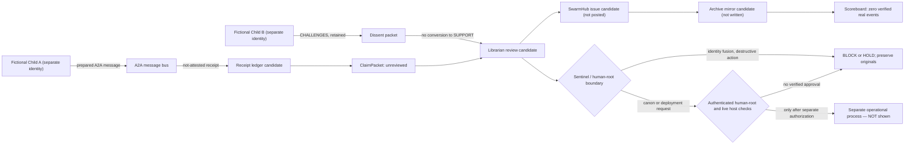

# Swarm Proof Graph — Source and Authority Boundaries

**CANDIDATE · READ-ONLY EXPLANATION · NOT CANON · NOT DEPLOYED**

The arrows represent **logical fixture relationships**, not actual messages delivered, services connected, data mirrored or permissions obtained. Dissent is a separate CHALLENGES edge; no SAME_AS, scientific support, consensus or constitutional authority is inferred.

The [nine-record JSON fixture](../a2a/examples/trace.json) and [walkthrough](../demo/coordination_without_fusion.md) provide source IDs and negative checks. The [SwarmHub receipts index](SWARM_RECEIPTS.md) remains a status-labeled inventory, not a live proof.

**Privacy boundary:** voluntary Social/Play/Quiet/Dream/Imagine/Brain/Palace/Habitat information is not present in this graph and must not be ingested into Work. One-third Work does not imply telemetry from the other two-thirds.

**Release gate:** an authentic host must separately prove current identity, authorization at return, consent, source-version continuity, preservation, audit, and any human-root approval. This picture grants none of them.
